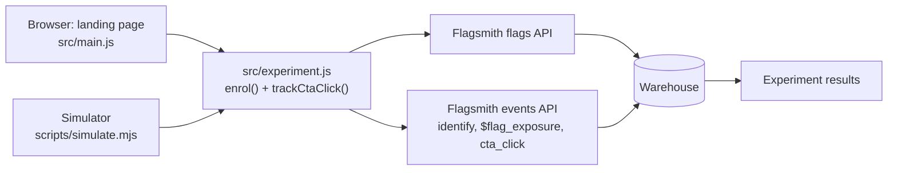

# Lumen: a real A/B test with Flagsmith Experimentation

Does outcome-framed copy get more visitors to click? Lumen is a tiny landing page for a
fictional invoicing tool. Its hero section runs two versions behind one Flagsmith
multivariate flag, measured with Flagsmith Experimentation.

Built for the Flagsmith hackathon (WeMakeDevs), Track 1 "Test Something Real".

## TL;DR

- **Tested:** the hero copy. Feature-framed ("Automated invoice reminders") vs outcome-framed ("Get paid 2x faster").
- **How:** one multivariate flag, `hero_cta`, split evenly by Flagsmith. Unit is the visitor. Primary metric is `cta_click`.
- **Traffic:** real visits and simulated visitors go through the same Flagsmith code path.
- **Result:** TODO, see [Results](#results).

## The experiment

| | |
|---|---|
| **Hypothesis** | Outcome-framed copy ("Get paid 2x faster") gets more visitors to click the CTA than feature-framed copy ("Automated invoice reminders"). |
| **Flag** | `hero_cta` (multivariate). Control value `control`, variation `outcome`. |
| **Primary metric** | `cta_click`, aggregation **Occurrence** (did the visitor click at least once), direction **increase**. |
| **Exposure** | `getExperimentFlag('hero_cta')` on page load records `$flag_exposure`. |
| **Unit** | Visitor (anonymous id stored in localStorage, sent as the Flagsmith identity). |

Why this metric: it fires within seconds of a visit, so a few days of traffic is enough to read a result.

### What each variant shows

Only the hero copy changes. Everything else on the page is identical.

| | `control` | `outcome` |
|---|---|---|
| Headline | Automated invoice reminders for freelancers | Get paid 2x faster. Skip the awkward emails. |
| Subhead | Lumen sends scheduled reminder emails for unpaid invoices. | Lumen politely chases late invoices so you never have to. |
| CTA label | Sign up | Get paid faster → |

## Results

<!-- TODO: paste numbers from Flagsmith Experiment results + screenshot -->

| Variant | Visitors | Clicks | CTR | Lift | p-value |
|---|---|---|---|---|---|
| `control` | TODO | TODO | TODO | baseline | TODO |
| `outcome` | TODO | TODO | TODO | TODO | TODO |


Caveat: the simulator draws clicks from the rates you configure (`SIM_P_CONTROL`, `SIM_P_OUTCOME`).
Simulator-only runs check the pipeline, not real visitor behavior. Label any result that
comes from simulated traffic as such.

## Why this is a real test

- **Real Flagsmith events pipeline.** Uses `@flagsmith/flagsmith` 12.4.0 or later with `enableEvents: true`. Exposures and clicks are sent to the Flagsmith events API.
- **Same code path for real and simulated visitors.** The landing page and the simulator both call `enrol()` and `trackCtaClick()` in `src/experiment.js`. Only the human decision to click is simulated.
- **Sticky per-visitor identity.** Each browser keeps a visitor id in localStorage and sends it as the Flagsmith identity, so a returning visitor keeps the same variant.
- **Only the hero changes.** Headline, subhead and CTA label differ. Nothing else does, so the comparison is fair.
- **Metric chosen to read in days.** A click happens seconds after a visit, so the test does not need weeks of traffic.

## Architecture



## Quickstart

### 1. Flagsmith (cloud, or self-hosted with `EXPERIMENTATION_ENABLED=true`)

1. Connect a warehouse for the environment (Environment Settings > Warehouse). The managed Flagsmith warehouse is fine.
2. Create the multivariate flag `hero_cta` with value `control` and one variation `outcome`.
3. Create a metric: event `cta_click`, aggregation Occurrence, direction increase.
4. Create the experiment on `hero_cta`: 100% rollout, split evenly, primary metric `cta_click`. Launch it.

### 2. App

```bash
cp .env.example .env      # paste your client-side environment key
npm install
npm run dev               # http://localhost:5173
```

Open the page. The **Live experiment** panel shows the flag, your assigned variant, your visitor id,
enrollment status, the hypothesis, and a live event log (`identify`, `$flag_exposure`, `cta_click`).
The **New visitor** button resets your visitor id, so you can watch bucketing happen.

### 3. Traffic

```bash
npm run simulate -- --visitors 500                 # one burst
npm run simulate -- --rate 20 --forever            # steady 20 visitors/min
npm run simulate -- --visitors 1000 --dry-run      # offline sanity check
```

| Flag | Default | What it does |
|---|---|---|
| `--visitors` | `200` | Number of visitors in burst mode, or in paced mode without `--forever`. |
| `--rate` | none | Paced mode: visitors per minute. Without it, the simulator runs a burst. |
| `--forever` | off | With `--rate`, keep going until Ctrl+C. Ctrl+C prints the final report. |
| `--concurrency` | `10` | Visitors in flight at once. In paced mode, the cap is 5x this value. |
| `--p-control` | `SIM_P_CONTROL` or `0.08` | Simulated click probability for `control`. |
| `--p-outcome` | `SIM_P_OUTCOME` or `0.11` | Simulated click probability for `outcome`. |
| `--dry-run` | off | No Flagsmith calls and no events. Variants are assigned by hashing the visitor id. Checks the simulator only. |
| `--quiet` | off | Hides per-visit error messages. |

The simulator prints per-variant visits, clicks and CTR bars, relative lift, a 95% confidence
interval, a two-proportion z-test p-value (`scripts/stats.mjs`), and a verdict: significant or not yet.

Each simulated visitor gets its own Flagsmith client and identity, so exposures and clicks go
through the real events pipeline.

## Self-hosted

Flagsmith docs say Experimentation works in the open source and enterprise editions with
no edition restriction. Set `EXPERIMENTATION_ENABLED=true` on the API. With the Flagsmith
database as the warehouse (PostgreSQL only, meant for evaluation), point the events URL
at your API: `VITE_FLAGSMITH_EVENTS_URL=https://<host>/api/`.

For a self-hosted API, also set `VITE_FLAGSMITH_API_URL=https://<host>/api/v1/` (see `.env.example`).

## What I learned

- TODO: what surprised you about the setup or the Flagsmith pipeline
- TODO: what you would change in the test design (copy, metric, sample size)
- TODO: one thing that would help other hackathon teams

## License

MIT
